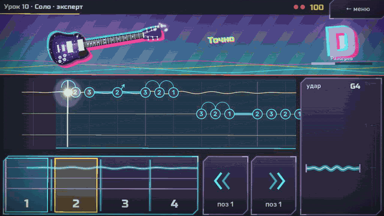
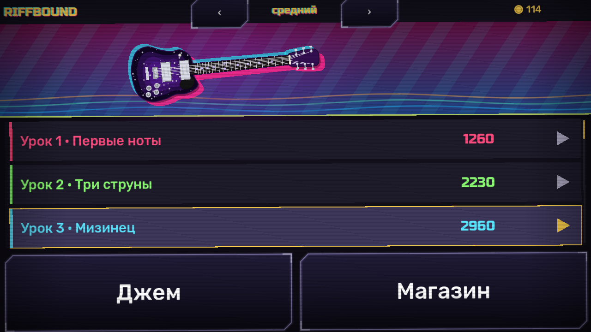
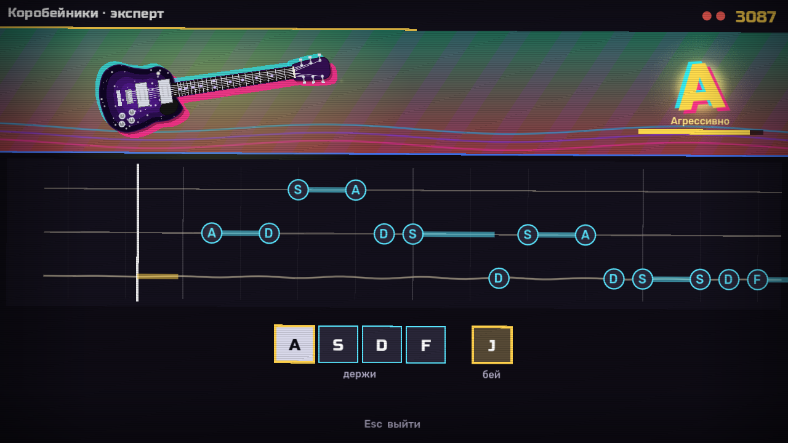
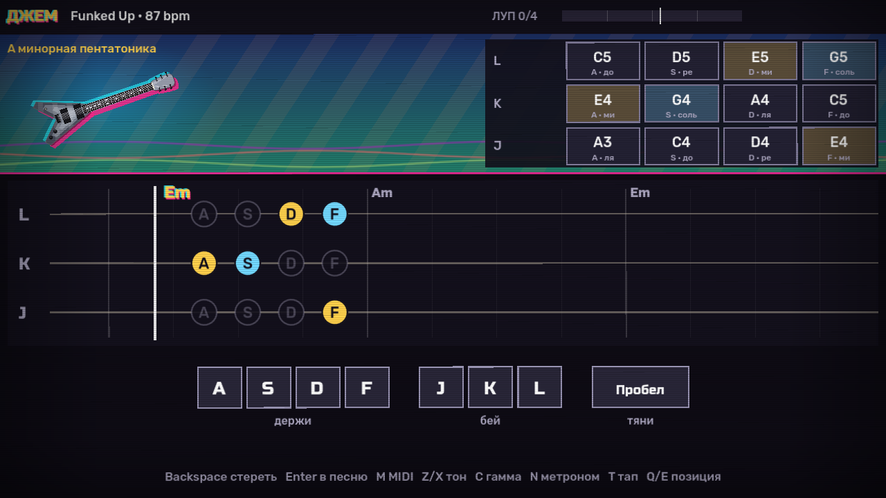
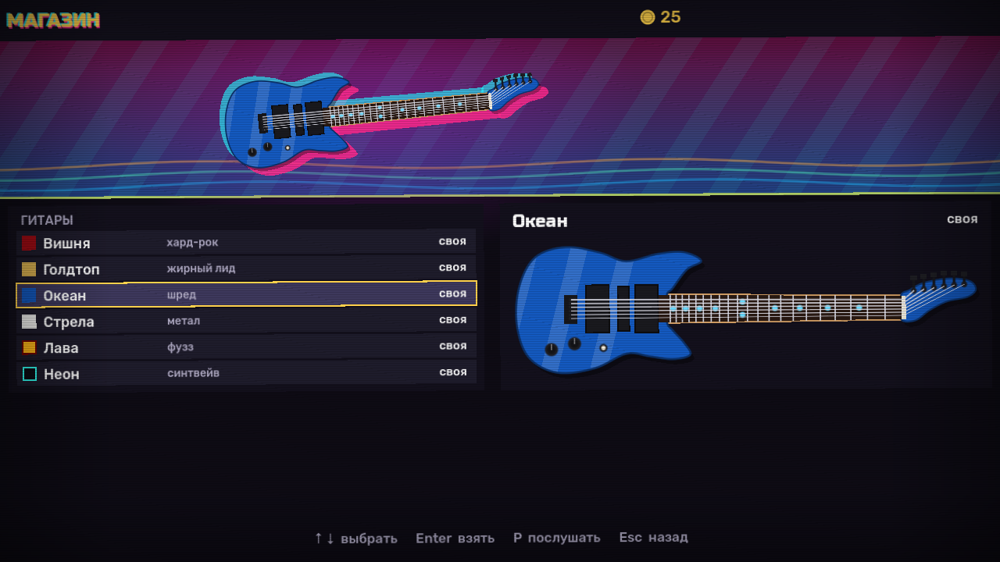
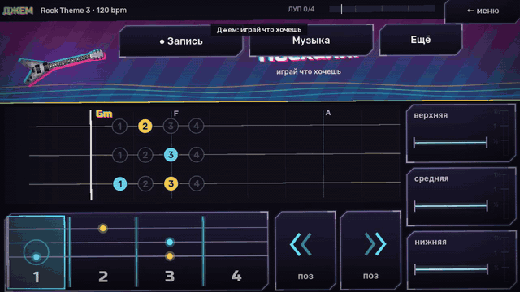

# Riffbound — симулятор гитары на клавиатуре

**Скачать для Android:** APK в разделе [Releases](https://github.com/kuanish-dev/Riffbound/releases).



Играешь на гитаре клавишами: левая рука держит лады, правая бьёт по одной из трёх струн. Песни идут табом
по дорожке, как в Guitar Hero / Rocksmith: нужно попасть в ноту, в долю и в технику (хаммер-он, пулл-офф,
бенд), держать длинные ноты. В джеме — свободная игра под барабаны с басом и клавишами, под готовые треки или под свои
файлы (темп и тональность подстраиваются сами), лупер, свои песни из лупа и экспорт в MIDI. Звук — настоящие
сэмплы гитары (через перегруз и кабинет), баса и барабанов; игра сама сводит из них подложку в нужном темпе
по аккордам песни, а в джеме подсвечивает, какие ноты сейчас звучат в аккорд. Godot 4.7, GDScript, всё строится кодом. Авторы и лицензии звуков, треков, шрифтов и текстур —
[CREDITS.md](CREDITS.md).

| Меню | Песня на клавиатуре |
|---|---|
|  |  |
| **Джем с панелью «Ещё»** | **Магазин гитар** |
|  |  |

## Управление
| Клавиша | Что делает |
|---|---|
| A / S / D / F | лады 1 / 2 / 3 / 4 (держать); звучит верхний из зажатых. 4-й — мизинец: первая нота соседней струны |
| J / K / L | удар по нижней / средней / верхней струне — в этот момент звучит нота |
| отпустить лад | нота глохнет (звенит, пока держишь) |
| удар без лада | глушняк (x) |
| один лад + удар по двум струнам | пауэр-аккорд (на одном ладу струны дают квинту) |
| лад выше, пока струна звенит | хаммер-он — новая нота без удара (окно 0.65 с) |
| снять верхний лад при зажатом нижнем | пулл-офф |
| пробел | бенд на тон, пока держишь (большой палец левой руки); покачивать — вибрато |
| Q / E | позиция руки: сетка нот на струну ниже / выше |
| N | метроном поверх музыки — включить / выключить (в меню, песне и джеме) |
| [ / ] | задержка удара −/+ 5 мс (калибровка) |
| ↑ ↓ Enter Tab Esc | меню: выбрать песню / играть / джем / выход; в песне и джеме Esc — к песням |
| ← → | в меню — сложность выбранной песни: новичок / лёгкий / средний / сложный / эксперт (на сенсоре — стрелки ‹ › сверху) |
| G | в меню — магазин гитар |

Джем: R — записать луп (один круг, 4 такта), V — музыка (см. ниже), Tab — панель «Ещё»: Z / X — тональность,
C — гамма, T — тап-темп, N — метроном, Backspace — стереть последний слой, Enter — последний слой в список
песен, − — удалить свою песню, M — экспорт слоёв в MIDI (`Документы/Riffbound/`), и карта нот на клавишах.
Клавиши физические — работают и в русской раскладке.

### Интерфейс
Минимальный: на экране только то, что нужно сейчас. На ноте написано, что зажать (на клавиатуре — клавиша лада
A/S/D/F, на сенсоре — цифра кнопки), а перед каждой нотой мигают золотом ровно те клавиши или кнопки, которые надо
нажать. Кнопки бенда и позиции есть, только если они нужны в этой песне; сверху — название и счёт, внизу на
клавиатуре — одна строка подсказки. В начале песни — одна фраза, что делать.

Сдвиг руки по грифу: на дорожке, где новая позиция начинается, стоит золотая метка — клавиша и стрелки, сколько раз
жать (`Q «` — на одну вниз, `E »»` — на две вверх; на сенсоре — `«` / `»»`, как на кнопках). Когда пора сдвигать,
мигает нужная клавиша или кнопка (с «×2», если жать дважды) и надпись «рука: …» у линии; номер текущей позиции —
под клавишами Q/E и на кнопке позиции. У каждой позиции свой цвет (`Ink.POSITIONS`): ноты рифа и полоса под ним на дорожке,
края клавиш A S D F и гриф на сенсоре — цветом позиции руки; цвет рифа впереди не совпал с цветом ладов — пора сдвигать.

В джеме справа от линии удара — сетка ладов: горят ноты, которые звучат в аккорд с музыкой прямо сейчас
(корень аккорда — золотом, остальные — голубым), над ней — имя аккорда, а следующие аккорды едут по дорожке
к линии. Обведена нота, которая звенит. В панели «Ещё» ноты аккорда так же подсвечены на карте.

### Сложность (core/difficulty.gd)
Пять уровней — чем выше, тем больше механик включено. Уровень у каждой песни свой: уровень выбранной песни —
сверху меню (‹ › или ← →). Уровень пройден, если доиграл песню до конца — как в OSU: две ошибки подряд (пропущенные
ноты; аккорд — одна ошибка) — провал, песня обрывается, ни рекорда, ни монет. Сколько ошибок ещё можно — красные точки
у счёта, попадание их восстанавливает. Песня в списке окрашена цветом самого сложного пройденного уровня, справа —
рекорд на нём: зелёный — новичок, голубой — лёгкий, жёлтый — средний, оранжевый — сложный, розовый — эксперт;
белая — ещё не пройдена.
Песня, которую ещё не выбирали, открывается на первом непройденном уровне. Выбор запоминается; рекорды и звёзды у каждого уровня свои
(прежние рекорды — «эксперт»). Урок на любом уровне оставляет то, чему учит (`keeps` урока): в «Бенде» — бенды,
в «Легато» — легато и все восьмые, в «Позициях» руку двигаешь сам; уровень меняет остальное и окно попадания.

| Уровень | Ноты | Что включено | Окно попадания | Монеты |
|---|---|---|---|---|
| новичок | только сильные доли (1-я и 3-я) | одна нота за раз, рука сама едет по грифу | ×1,8 | ×0,3 |
| лёгкий | каждая доля | одна нота за раз, рука сама едет по грифу | ×1,6 | ×0,45 |
| средний | каждая доля | + аккорды и глушняки, руку двигаешь сам (Q/E) | ×1,4 | ×0,6 |
| сложный | + каждая вторая слабая доля в пробежках | + легато и бенды | ×1,2 | ×0,8 |
| эксперт | все ноты, как в табе | всё | как есть | ×1 |

## Подложки и треки (audio/backing.gd, core/tracks.gd)
V в джеме листает по кругу:
- **стили** — барабаны и бас из сэмплов и тихие клавиши (синтез кодом), луп на 4 такта в темпе джема: рок,
  медленный (половинный размер), шаффл (свинг), метал (двойная бочка, без клавиш), тишина. В конце круга —
  сбивка (`fill`), на первую долю — тарелка. Аккорды круга — от тональности строя (минор i–i–VI–VII, как
  Em–Em–C–D; мажор I–I–IV–V): бас играет их ступени, клавиши — сам аккорд. В песне стиль играет её аккорды;
- **треки** — шесть CC0-петель с OpenGameArt; темп, сильная доля, тональность и аккорд каждого такта посчитаны
  заранее по звуку (`tools/build_assets.py`), при выборе строй гитары встаёт в тональность трека, сетка
  и лупер — в его темп;
- **треки песен** — живая группа под каждую песню (кроме уроков), в джеме — под свою импровизацию;
- **свои треки** — файлы `.ogg` / `.mp3` / `.wav` из папки `Документы/Riffbound` (туда же сохраняется MIDI;
  папка создаётся сама). Темп и тональность берутся из имени: `Blues Jam 120bpm Am.mp3`, `Ballad Eb major 70 BPM.ogg`.
  Нет в имени — T: стучи в такт, начиная с «раз», 6+ ударов и пауза — темп и сильная доля запомнятся;
  тональность — Z / X / C, тоже запоминается (`user://user_tracks.json`).

Метроном (N) играет поверх любой подложки и песни: щелчок на каждую долю, на первую — выше.
Тап-темп под стилем меняет темп джема. Темп своей песни из лупа — тот, под который её играли.
На Android игра один раз спрашивает доступ к музыке и аудио — без него свои треки не видны.

### Сенсор (view/touch_pad.gd)
На телефоне и планшете (или на компьютере с флагом `--touch`, мышь — как палец) в меню одно касание песни —
сразу играть (срабатывает, когда отпускаешь палец), список листается пальцем вверх-вниз, внизу — «Джем»
и «Магазин». Все кнопки под палец (тест
`test_buttons_fit_a_finger`: не меньше 100 × 60 — около 9,5 × 5,7 мм на телефоне 6,5"). В песне внизу экрана кнопки:
слева четыре лада (держать пальцем; проведи на соседний лад — легато), посередине сдвиг позиции (если нужен
в песне), справа три крупные струны столбиком, как на дорожке — верхняя сверху (касание — удар; проведи пальцем
сверху вниз через струны — бой; ударь и, не отпуская, потяни палец вбок — бенд: чем дальше, тем выше, до полутора
тонов, верни или отпусти — струна отпущена; покачивай палец на струне туда-сюда — вибрато; пока струна звенит,
проведи пальцем по ладам — слайд, звук плавно съезжает на новую ноту). Мультитач: лад
держит одна рука, бьёт другая. В джеме — «Запись», «Музыка» и «Ещё» (стереть, в песню, MIDI, тон, гамма,
метроном, тап); в магазине — коснись гитары, ещё раз (или большая кнопка) — купить или надеть; «← меню» в углу. Ориентация на устройстве — горизонтальная.



Кнопки гитары нарисованы как части инструмента (view/pad_art.gd). Лады — гриф: порожки между кнопками, три струны
поперёк (верхняя сверху, как на дорожке); звенящая струна светится от зажатого лада, по ней пробегает огонёк слайда;
в джеме точки на грифе — ноты аккорда (корень золотом), в песне — куда жать дальше. Струны — сами струны: дрожат
от удара, при бенде выгибаются в точке, где палец взял струну, справа шкала «½ · 1 · 1½ тона», сверху — нота,
которая звучит (с бендом — уже подтянутая); от вибрато по струне бежит рябь. Остальные кнопки — неоновые панели.

## Вид (view/)
В духе Hotline Miami: сцена — неоновый градиент, цвета которого плывут, косые полосы и волны, всё бьётся
в долю; на ней одна гитара крупно — качается, подпрыгивает, за ней сдвинутые розовый и голубой силуэты.
Надписи (оценки, техника, отсчёт, ранг стиля, заголовки) — жирные, с цветными сдвинутыми слоями и наклоном.
Весь экран чуть качается и трясётся от ударов, поверх — сканлайны и затемнённые края.

### Звуки отклика (audio/ui_sounds.gd)
На каждое действие — короткий звук, собранный кодом (ноты и шум по рецептам `UiSounds.SOUNDS`):
перемещение по списку и касание строки, выбор, назад, старт песни и джема, позиция руки (или отказ, если дальше
некуда), калибровка, метроном вкл/выкл, тональность, гамма, подложка; в магазине — покупка («касса»),
«надеть», «не хватает монет»; в джеме — запись, готовый слой, стереть, сохранить песню, удалить, MIDI, удары
тап-темпа и принятый темп; в песне — промах и «не та нота», техника, рост множителя серии, финиш, провал и новый рекорд.

## Магазин гитар (core/shop.gd, view/guitar_art.gd)
Песни дают монеты: 10 за звезду, одну за каждые 1000 очков и бонус за лучший стиль (при первом запуске
с магазином — сразу за уже набранные рекорды). На них в магазине (G в меню) покупаются электрогитары; надетая — на сцене,
в магазине там же примеряется выбранная. ↑ ↓ — выбрать, Enter — купить (и сразу надеть) или надеть купленную,
P — послушать фразу её звуком (или играй на ней J K L прямо в магазине).

У каждой гитары свой звук — цепочка эффектов Godot на шине гитары (перегруз, эквалайзер, фильтры, дилей,
реверб, хорус, фэйзер, компрессор; в конце всегда лимитер). Громкость выровнена замером (`--tones`).

| Гитара | Форма | Звук | Цена |
|---|---|---|---|
| Классика (санбёрст) | классическая, SSS | кранч — как есть | даром |
| Полночь | классическая, SSS | блюз — тёплый, с комнатой | 60 |
| Вишня | двурогая, HH | хард-рок — перегруз, середина, слэпбек | 100 |
| Голдтоп | одиночный вырез, HH | жирный лид — тёплый перегруз, дилей, зал | 150 |
| Океан (металлик) | суперстрат, HSH | шред — хай-гейн, вырезанная середина, стерео-дилей | 200 |
| Стрела | V-образная, HH | метал — плотный, сжатый | 250 |
| Лава (санбёрст) | угловатая, HH | фузз | 300 |
| Неон (светящийся кант) | суперстрат, HH | синтвейв — хорус, дилей, большой зал | 400 |
| Галактика (искры) | одиночный вырез, HH | космос — фэйзер, длинный дилей, огромный реверб | 500 |
| Хром | V-образная, HH | индастриал — цифровой лоу-фай, полосовой фильтр | 700 |

Гитары рисуются кодом: корпус по контуру формы, отделка, накладка, звукосниматели, бридж, ручки, гриф с ладами
и метками, голова с колками, шесть струн. Новая гитара — строка в `Shop.SKINS` (форма из `GuitarArt.SHAPES`).
Монеты и купленное — `user://shop.json`.

## Строй (core/tuning.gd)
Кнопка — ступень гаммы: три ноты на струну, следующая струна продолжает гамму; 4-й лад достаёт первую ноту
соседней струны (как мизинец на гитаре — струны перекрываются), позиция сдвигает сетку на струну.
Строй песен — ми-минорная пентатоника:

| | лад 1 (A) | лад 2 (S) | лад 3 (D) | лад 4 (F) |
|---|---|---|---|---|
| верхняя (L) | G4 | A4 | B4 | D5 |
| средняя (K) | B3 | D4 | E4 | G4 |
| нижняя (J) | E3 | G3 | A3 | B3 |

Гаммы: минорная и мажорная пентатоника, блюзовая, натуральный и гармонический минор, дорийский, мажор, хроматика; любая
тональность; позиции — пока девять нот в диапазоне E2–E6. Подложка джема подстраивается (минор i–i–VI–VII, мажор I–I–IV–V).

## Песни (core/songs.gd)
Таб по тактам: строка на струну, восемь восьмых. Клетка: `-` пусто, `1`…`4` удар по ладу, `x` глушняк,
`h2` / `p1` легато к ладу без удара, `…b` бенд, `=` держать ноту ещё восьмую; `pos` такта — позиция руки.
Перед первым тактом два такта отсчёта. У песни свой стиль подложки (`backing`), темп (`bpm`, по умолчанию 100)
и аккорды (`chords` — по одному на такт, `"Am E"` — два аккорда делят такт): по ним играют бас и клавиши,
отсчёт — на первом аккорде.

Список идёт от лёгкого к трудному: сначала десять уроков — каждый вводит одну механику, потом песни по нарастающей.
Каждая песня играет под свой трек — живую группу: барабаны, бас, две ритм-гитары и струнные, сведённые из настоящих
сэмплов (`tools/band.py`), а не собранные игрой на лету. Ноты, аккорды и аранжировки — `tools/classics_data.py`;
из него собираются табы и треки (`python -I tools/classics.py book`) и звук треков (`… render <папка_сэмплов>`).
Порядок держит `ProgressionTests`: трудность песни (плотность нот + техники) не падает, а техника песни сначала
встречается в уроке. Треки уроков в джем не попадают. В начале песни, пока идёт отсчёт, — фраза, что делать.

| Урок | Чему учит | Группа, bpm |
|---|---|---|
| 1 · Первые ноты | лады 1–3 на нижней струне, по долям | простой бит, 80 |
| 2 · Три струны | те же лады на нижней, средней и верхней струне | простой бит, 80 |
| 3 · Мизинец | 4-й лад: четыре ноты на струне вверх и вниз | простой бит, 85 |
| 4 · Длинные ноты | держать лад, пока звенит нота | баллада, 85 |
| 5 · Восьмые | ноты вдвое чаще, ровный ритм | рок, 90 |
| 6 · Аккорды и глушняки | один лад + удар по двум струнам, удар без лада | метал, 95 |
| 7 · Легато | хаммер-оны и пулл-оффы — ноты без удара | баллада, 100 |
| 8 · Бенд | подтяжка струны на тон | баллада, 85 |
| 9 · Позиции | сдвиг руки по грифу, цвет каждой позиции | простой бит, 85 |
| 10 · Соло | бенды, легато и сдвиг руки вместе | рок, 100 |

| Песня | Чем трудна | Группа, bpm |
|---|---|---|
| Ода к радости | Бетховен, ля мажор: ноты по долям — самая простая | баллада, 92 |
| Лебединое озеро | Чайковский, си минор: длинные ноты и короткие пробежки | баллада, 84 |
| Симфония №5 | Бетховен, до минор: мотив судьбы — три быстрых удара и долгая нота | удары всей группой, 140 |
| Коробейники | народная, ля минор: тема из «Тетриса», восьмые | рок, 116 |
| К Элизе | Бетховен: хроматика (ре# между ре и ми), под подголосок чистой гитарой | тяжёлая баллада, 140 |
| В пещере горного короля | Григ, ми минор: разгон восьмыми | метал, 100 |
| Токката ре минор | Бах: пулл-оффы, хаммер-оны, сдвиг позиции | метал, 92 |
| Канон ре мажор | Пахельбель: восьмые и два сдвига позиции | рок, 100 |
| Турецкий марш | Моцарт: быстрые легато и сдвиги позиции | метал, 150 |
| Полёт шмеля | Римский-Корсаков: хроматика без остановки, легато | метал, 150 |

Мелодии — классика и народные, давно в общественном достоянии; рок-соло под авторским правом в игру не входят.

### Стиль (core/style_meter.gd)
Как в слэшерах: в углу сцены — ранг стиля **D → C → B → A → S → SS → SSS**. Точные попадания, техника
и удержание наполняют шкалу; повтор одного и того же приёма (та же струна, лад и техника среди последних
четырёх) даёт меньше — нужна разнообразная игра. Шкала сама тает, на высоких рангах быстрее; промах роняет
на ранг, «не та нота» — на полранга. Взлёт ранга — буква выскакивает, экран вздрагивает и вспыхивает цветом
ранга, звучит «вжух»; чем выше стиль, тем ярче бьётся фон, сильнее качаются гитара и экран. Лучший стиль
песни — в итоге и в монетах (от 0 за D до 15 за SSS).

Оценка (core/song_judge.gd): нота засчитывается, если сыграна на своей струне нужной высоты в окно доли
(«Точно» ±45 мс, «Хорошо» ±95 мс) — ударом или легато. Совпавшая техника — бонус, удержание длинной ноты —
очки за удержанные восьмые, серия — множитель до ×4. Удар не той высоты рядом с нотой песни обрывает серию;
игра между нотами и случайное легато не наказываются. Звёзды — по доле сыгранных нот (50/70/85/95/100%).
Рекорды — `user://scores.json`, свои песни из джема — `user://my_songs.json`.

## Android
`build/Riffbound.apk` (arm64): релизная сборка, подписанная ключом отладки — для установки на свой
телефон (в настройках разрешить установку из этого источника). Пересобрать после изменений:
```sh
JAVA_HOME=/opt/homebrew/opt/openjdk@17/libexec/openjdk.jdk/Contents/Home \
GODOT_ANDROID_KEYSTORE_RELEASE_PATH=$HOME/.android/debug.keystore \
GODOT_ANDROID_KEYSTORE_RELEASE_USER=androiddebugkey GODOT_ANDROID_KEYSTORE_RELEASE_PASSWORD=android \
godot --headless --path . --export-release "Android" build/Riffbound.apk
```
Нужны шаблоны экспорта Godot 4.7.2 (Android уже распакован в `~/Library/Application Support/Godot/export_templates/`),
Android SDK из Homebrew (`/opt/homebrew/share/android-commandlinetools`, прописан в настройках редактора) и Java 17.
Поставить по USB: `adb install -r build/Riffbound.apk`.

## Устройство
```
app/               main.gd — режимы и маршрут команд (COMMANDS); scene_builder.gd — сборка сцены;
                   music_loader.gd — подложка, метроном, фоновая сборка; jam_session.gd, shop_screen.gd,
                   common_commands.gd — команды режимов; tap_tempo.gd; guitar_router.gd — гитара → события
                   {kind, string, fret, pos, midis, amount}; layer_voices.gd — голоса слоёв лупера; feedback.gd — звуки отклика
core/              логика без показа
  timing.gd        темп (переменный), восьмые, окна оценки
  conductor.gd     часы песни по позиции звука: круг музыки в целых тактах, сильная доля, калибровка
  tracks.gd        треки: встроенные CC0-петли, треки песен (song_tracks.gd) и свои файлы (имя → темп и тональность)
  fretboard.gd     лады, удары, глушение, легато, бенд, окно прощения
  tuning.gd        строй: тональность, гаммы, позиции → MIDI
  harmony.gd       аккорды: имя → ноты, аккорд на доле, круг тональности
  notes.gd         лады и струны
  songs.gd         песни: все, ноты, аккорды, свои песни из лупа, рекорды
  song_book.gd     уроки и песни (табы, собраны tools/classics.py); tab_reader.gd — таб → ноты; layer_song.gd — слой лупера → ноты
  shop.gd          магазин: монеты за песни, скины гитар (SKINS), купленное и надетое
  song_judge.gd    оценка игры по табу; наружу — факты fact(kind, data)
  style_meter.gd   стиль D…SSS из фактов оценки: набор, разнообразие, таяние, падения
  looper.gd        лупер джема; midi_file.gd — экспорт слоёв в SMF
audio/             backing.gd — подложка из сэмплов по аккордам (STYLES); sample_bank.gd — сэмплы гитары; sfx.gd — звуки стиля;
                   ui_sounds.gd — звуки отклика на действия;
                   guitar_voices.gd, string_voice.gd — голоса
view/              stage_view.gd — неоновая сцена с гитарой, fx_layer.gd — свечение и искры, crt_overlay.gd —
                   сканлайны и виньетка, style_view.gd — буква ранга, shaker.gd — тряска экрана, layout.gd, glyph.gd
  hud/             hud.gd — слои интерфейса: экран на режим (menu/song/results/jam/shop_view.gd), key_controls.gd,
                   touch_controls.gd, toast.gd; общее — lanes.gd (дорожка), cue.gd, chord_guide.gd, note_map.gd, loop_bar.gd
  touch/           touch_pad.gd — пальцы → действия ввода; touch_buttons.gd, touch_lists.gd — раскладка; bend_gesture.gd;
                   pad_art.gd, string_art.gd, neck_art.gd — кнопки, струны, гриф
  guitar/          guitar_art.gd — электрогитара кодом, guitar_shapes.gd — формы корпусов и головок
assets/            guitar/ bass/ drums/ tracks/ fx/ fonts/ — собраны tools/build_assets.py (источники — CREDITS.md)
dev/               dev_args.gd, test_runner.gd + tests/, simulation.gd + autoplay.gd (бот играет песни по табу),
                   screenshot.gd + gestures.gd (снимки, жесты пальцами), tone_meter.gd (громкость гитар)
tools/             build_assets.py + track_analysis.py — ассеты из загрузок; classics.py + classics_data.py — уроки
                   и песни: табы и треки; band.py + band_score.py + band_samples.py — подложки живой группой
```

## Команды разработки
```sh
godot --headless --path . --import                                              # после новых class_name
perl -e 'alarm 120; exec @ARGV' godot --headless --path . -- --test             # тесты
perl -e 'alarm 150; exec @ARGV' godot --headless --fixed-fps 120 --path . -- --sim      # бот играет все песни
perl -e 'alarm 150; exec @ARGV' godot --path . -- --screenshot=<png> --song=4 --at=14 --autoplay  # кадр песни
perl -e 'alarm 150; exec @ARGV' godot --path . -- --screenshot=<png> --menu     # меню
godot --path . -- --play --song=3                                               # сразу песня
godot --path . -- --jam                                                         # сразу джем
godot --path . -- --jam --backing=funked_up                                     # джем под трек (id из Tracks/Backing)
godot --path . -- --touch                                                       # сенсорные кнопки, мышь как палец
godot --path . -- --metronome                                                   # метроном включён с запуска
godot --path . -- --jam --more                                                  # джем с открытой панелью «Ещё»
perl -e 'alarm 150; exec @ARGV' godot --path . -- --screenshot=<png> --shop --skin=3   # магазин, 4-я гитара
perl -e 'alarm 120; exec @ARGV' godot --path . -- --tones                       # громкость звука каждой гитары
godot --path .                                                                  # играть
```

Пересобрать `assets/` из исходных файлов (ссылки — в CREDITS.md; нужны numpy, scipy, soundfile, librosa, ffmpeg):
```sh
python tools/build_assets.py <папка_загрузок>          # tracks/ guitar/ bass/ drums/ kenney/ fonts/
python tools/build_assets.py <папка_загрузок> tracks   # только треки; печатает темп, такты, тональность
```

## Лицензия
Код Riffbound © 2026 kuanish-dev — под лицензией **GNU GPL v3.0** ([LICENSE](LICENSE)): его можно использовать,
изучать, менять и распространять, но изменённые версии и сборки на его основе тоже должны быть открыты под GPL-3.0.
Звуки, треки, текстуры и шрифты — под своими лицензиями (CC0, SIL OFL), авторы — в [CREDITS.md](CREDITS.md).
Движок Godot — под лицензией MIT.
